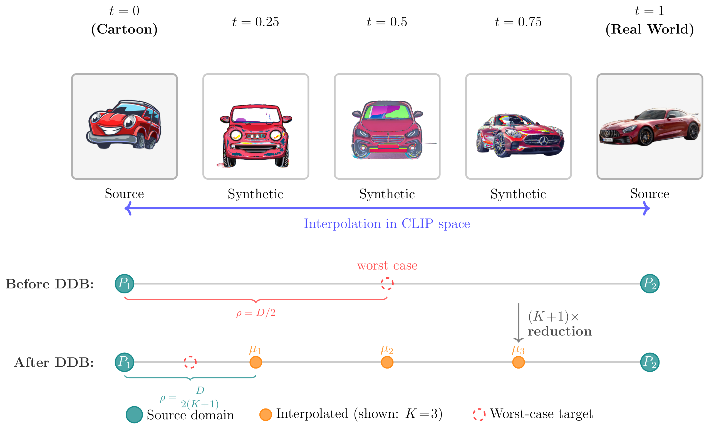
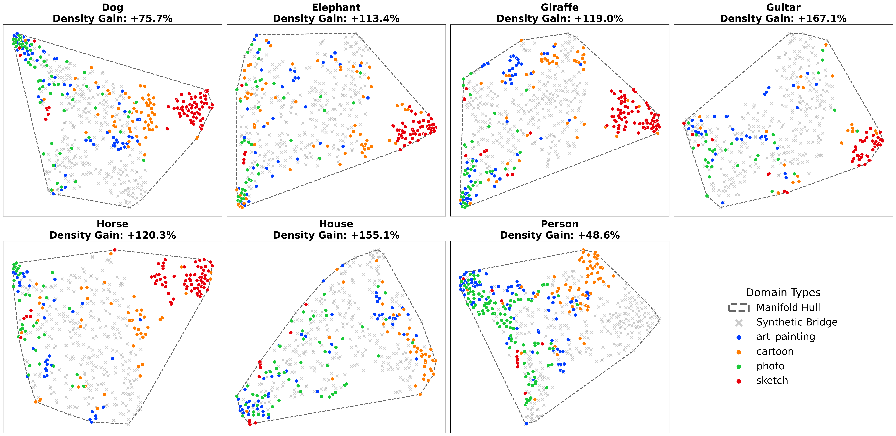
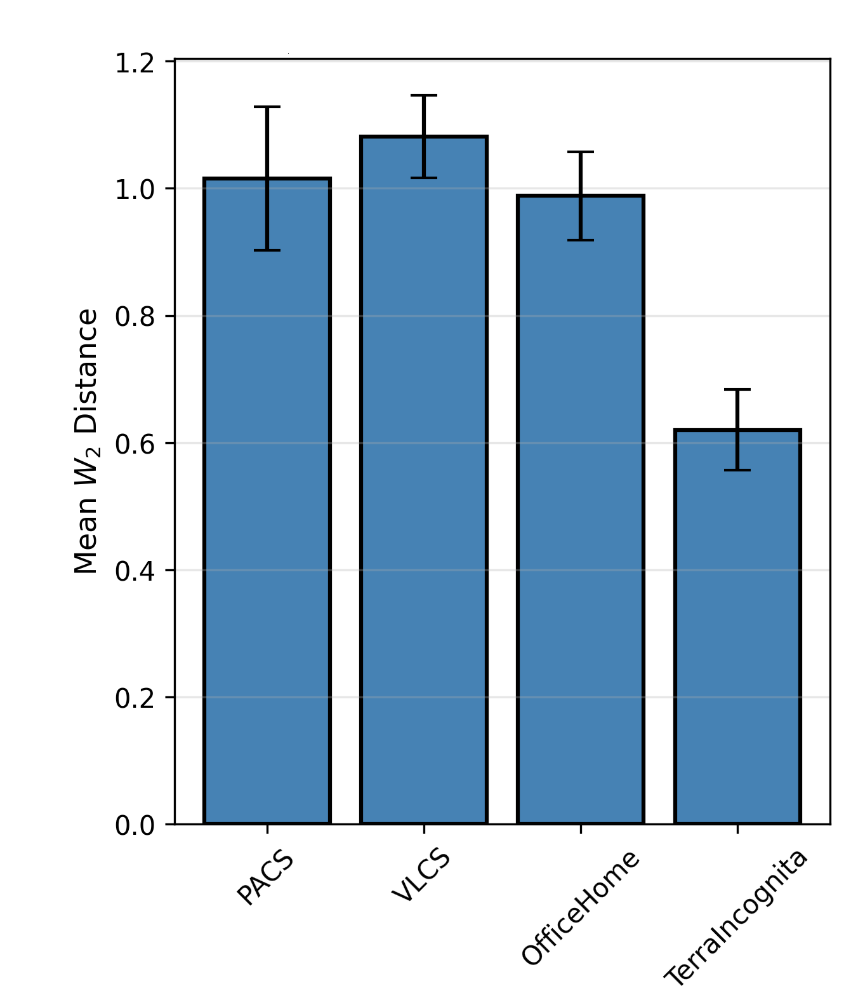
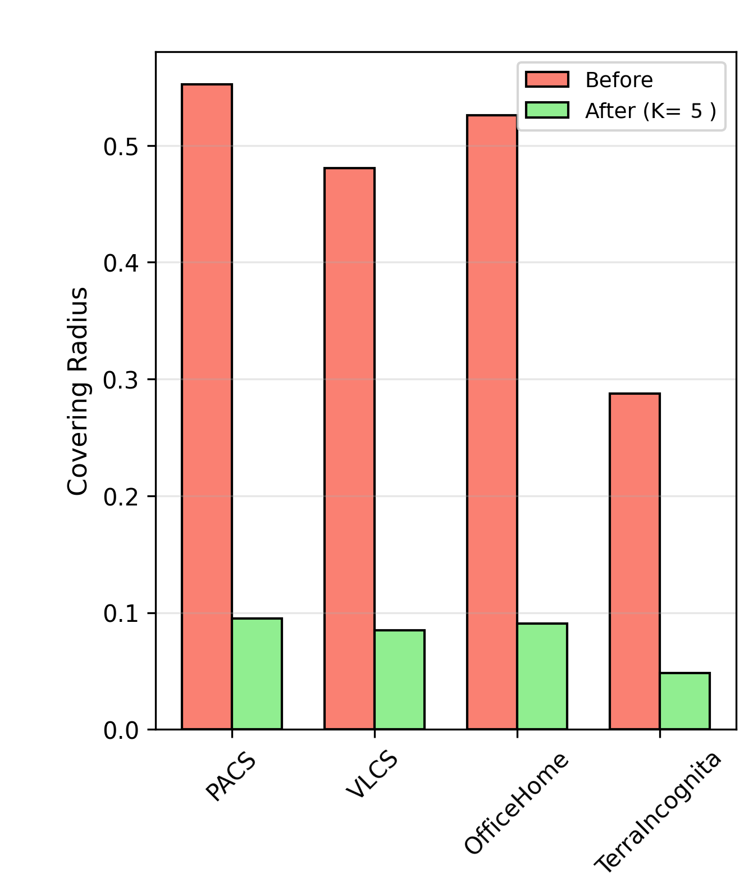
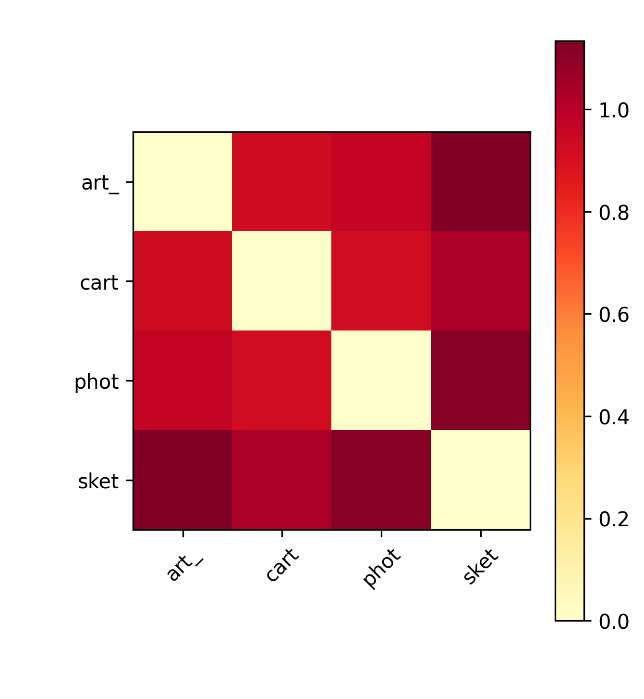

<div align="center">

# 🌉 Distribution Bridge

### Synthesizing Continuous Style Manifolds for Robust Domain Generalization

[](LICENSE)
[](environment/setup_env.sh)
[](https://github.com/facebookresearch/DomainBed)

**Mahmoud Soliman · Ahmed Elgazwy · Ahmed Radwan · Omar Abdelaziz · Ahmad Abdel-Qader · Mohamed S. Shehata**
*The University of British Columbia, Kelowna, BC, Canada*

</div>

<p align="center">
  
</p>

## TL;DR

Most domain generalization methods train on a handful of source domains and
hope the gaps between them don't matter. **Distribution Bridge (DDB) fills
those gaps in.** We treat each domain as a full probability distribution in
CLIP embedding space, walk along the Wasserstein geodesic that connects every
pair of source domains, and use a diffusion model to turn the points along
that walk back into real images. The result: a continuous style manifold
between your sources, backed by a formal guarantee on how much of the gap you've
closed, and a stack of synthetic training data that drops straight into any
DomainBed algorithm.

If that's all you needed to hear, jump to [Quickstart](#-quickstart). If you
want the mechanics, keep reading.

## Why this exists

Domain generalization benchmarks like PACS, OfficeHome, VLCS, and
TerraIncognita hand you a handful of discrete domains and ask your model to
generalize to one it has never seen. The implicit assumption behind most DG
methods — *invariance across sources implies robustness beyond them* — quietly
depends on the unseen target not being too far from what you trained on.
Nobody checks that assumption, because nobody has a cheap way to.

DDB takes it literally. Each domain-class pair is represented as a full
empirical distribution (not just a mean embedding), optimal transport gives us
the *exact* geodesic between two such distributions, and we place `K`
intermediate points along it. That's not a heuristic — it provably shrinks the
worst-case distance from any point on the geodesic to its nearest source by a
factor of `K+1`. We then condition an unCLIP diffusion decoder on those
interpolated points to turn math back into pixels, and train on the result
alongside the original data.

## ✨ Highlights

- **Distributional, not just mean-based interpolation.** Sinkhorn optimal
  transport + barycentric projection between full empirical CLIP
  distributions — not a straight line between two mean vectors.
- **A real theoretical guarantee.** `K` interpolants give a `(K+1)×` reduction
  in covering radius along the source geodesic (Proposition 3.5), which slots
  into a generalization bound decomposition you can actually reason about.
- **Model-agnostic.** The synthetic domains drop into DomainBed's training
  loop as ordinary labeled domains — works with ERM, DANN, Mixup, or anything
  else already implemented there.
- **Verifiable, not just plausible.** The repo ships the same scripts we used
  to empirically check our own theory — generation fidelity, extrapolation
  distance, covering-radius reduction — so you don't have to take the math on
  faith.

<p align="center">
  
</p>

<p align="center"><sub><i>t-SNE of PACS CLIP embeddings — colored markers are real domains, grey markers are DDB's synthetic samples filling the space between them (paper Fig. 3).</i></sub></p>

## 🚀 Quickstart

```sh
git clone https://github.com/MahmoudOsama97/Distribution_Bridge.git
cd Distribution_Bridge

# 1. Build the environment (venv + pinned deps + offline model cache)
export DDB_VENV=/path/to/ddb_env
export DDB_HF_HOME=/path/to/hf_cache
export DDB_TORCH_HOME=/path/to/torch_cache
./environment/setup_env.sh
source "$DDB_VENV/bin/activate"

# 2. Grab a benchmark (PACS, OfficeHome, VLCS, TerraIncognita, ...)
python -m domainbed.scripts.download --data_dir=./data

# 3. Extract CLIP embeddings for every domain-class pair
python -m distribution_bridge.generation.extract_embeddings \
  --data_root ./data/pacs --out_dir ./results/stage1_embeddings

# 4. Interpolate + generate synthetic domains along the source geodesics
python -m distribution_bridge.generation.generate_ot \
  --embeddings_dir ./results/stage1_embeddings \
  --data_root ./data/pacs --metadata_dir ./results/stage2_metadata

# 5. Train anything in DomainBed on the densified data
python -m domainbed.scripts.train \
  --data_dir ./data --dataset PACS --algorithm ERM --test_envs 0 \
  --hparams '{"k_syn_domains_per_step":3}'
```

Want a sanity check before committing GPU-hours to all of the above? Run
`distribution_bridge/smoke_test/smoke_test.py` first — it loads the pipeline,
encodes a handful of images, generates from one embedding, and checks the
round-trip cosine similarity.

Don't want to run Stage 1-2 yourself? Skip straight to [pre-generated
samples](#-pre-generated-synthetic-data) below.

## 🗺️ Repository layout

```
distribution_bridge/
├── generation/           ← the DDB generation pipeline (start here)
│   ├── unclip_pipeline.py       # unCLIP img2img-embeds pipeline (raw CLIP embedding → image)
│   ├── extract_embeddings.py    # Stage 1: CLIP embedding extraction + caching
│   ├── ot_interpolate.py        # Algorithm 1: Sinkhorn-OT + barycentric projection
│   ├── generate_ot.py           # Stage 2a: OT-interpolated synthetic domain generation
│   └── generate_diffsrc.py      # Stage 2b: no-interpolation control (endpoint conditioning)
├── data_prep/            ← builds condition-specific / K-sweep DomainBed data roots
├── analysis/             ← empirical checks on the paper's own theoretical claims
│   ├── common.py                 # shared exact-OT / D_max utilities
│   ├── eps_gen.py                 # generation fidelity (Assumption 3.4)
│   ├── eps_extrap.py              # extrapolation distance to the source 1-skeleton (Def. 3.4)
│   ├── table7_reconcile.py        # Table 7 covering-radius statistics, sanity-gated
│   └── eps_extrap_normalized.py   # eps_extrap under the ℓ2-normalized embedding convention
└── smoke_test/           ← environment + pipeline sanity checks

domainbed/                DomainBed training framework, extended with DDB's two-tiered
                           domain batching and SynDomain_* auto-discovery
environment/               environment setup script
slurm_examples/             example SLURM job templates, one per pipeline stage
```

## 🔬 How the pipeline actually works

This is the part worth reading closely if you're reproducing or extending DDB.
For every unordered pair of source domains `(i, j)` and every class `c`:

**1 — Embed.** (`extract_embeddings.py`) Every image goes through an OpenCLIP
ViT-H/14 image encoder into `R^1024`. We cache the full embedding matrix per
`(domain, class)`, not just its mean — the whole point is to interpolate
distributions, not points.

**2 — Transport.** (`ot_interpolate.py`, `generate_ot.py`) For each weight
`t ∈ {1/6, ..., 5/6}`, Algorithm 1 solves a Sinkhorn optimal-transport problem
between the two domains' class-conditional distributions, barycentrically
projects, and interpolates linearly at `t`. A subset of the resulting
interpolants condition the unCLIP decoder to produce images whose own CLIP
embeddings track the interpolated distribution — not an average of two
pictures, an image *of* a point on the geodesic.

Generated images land in
`SynDomain_OT_<domA>_<domB>_t<k>of6/<class>/*.jpg` — a folder-naming
convention DomainBed's `datasets.py` reads directly: it auto-discovers every
synthetic domain and automatically prunes any pair that touches the current
held-out test domain, so leave-one-domain-out evaluation stays leakage-free
for free.

**3 — Control for it.** (`generate_diffsrc.py`) Same decoder, same budget,
same everything — except the conditioning vectors come straight from the raw
source embeddings, no transport involved. This Diff-Src condition exists
specifically so you can ask "is the *interpolation* doing something, or is it
just more synthetic data?" and get an answer instead of a guess.

Both generators log every conditioning vector alongside the images they
produced, which is what makes the fidelity checks in `distribution_bridge/analysis/`
possible without re-running anything.

Runnable examples: `slurm_examples/01_extract_embeddings.sh` through
`03_generate_diffsrc.sh`.

## 🏋️ Training

`domainbed/scripts/train.py` implements DDB's two-tiered domain batching:
every step pulls one mini-batch from *each* original source domain, plus
`k_syn_domains_per_step` mini-batches from a random subset of the synthetic
domains available for that configuration. Synthetic data augments the
training mix — it never replaces the real sources. Point `--data_dir` at a
directory holding the original domain folders next to whatever `SynDomain_*`
folders Stage 2 produced (`slurm_examples/04_train_domainbed.sh` has a full
example). `distribution_bridge/data_prep/` has helpers for carving out
condition-specific data roots — OT-only, Diff-Src-only, or subsampled to a
fixed `K` for a covering-radius sweep.

## 📐 Checking our own math

A theoretical guarantee you can't verify is just a vibe. `distribution_bridge/analysis/`
re-encodes generated images and measures embedding-space quantities straight
from cached CLIP embeddings — no extra generation, no extra training:

| Script | What it checks |
|---|---|
| `eps_gen.py` | **Generation fidelity** — how closely a generated image's CLIP re-encoding lands back on its conditioning embedding (Assumption 3.4). |
| `eps_extrap.py` | **Extrapolation distance** — the worst-case Wasserstein-2 gap from a held-out target to the nearest point on the source 1-skeleton (Definition 3.4): how far outside the covering-radius guarantee a real target actually sits. |
| `table7_reconcile.py` | **Covering-radius statistics** — reproduces the paper's Table 7 from cached embeddings via exact optimal transport, with a pass/fail sanity gate against the published values before anything downstream runs. |
| `eps_extrap_normalized.py` | `eps_extrap.py`'s measurement under the ℓ2-normalized embedding convention, with argmin-t and nearest-source-pair tracking for the supplementary per-class breakdown. |

<p align="center">
  
  
  
</p>

<p align="center"><sub><i>Wasserstein distance analysis (paper Fig. 4) — mean pairwise W2 distance across benchmarks (left), covering radius before/after K=5 interpolation (middle, the predicted ~6× reduction), and the PACS pairwise distance heatmap (right). All three come straight out of <code>table7_reconcile.py</code>, not a spreadsheet.</i></sub></p>

## 📦 Pre-generated synthetic data

Running the full pipeline from scratch costs real GPU-hours, so a small,
representative sample of DDB's synthetic output — OT-interpolated and
Diff-Src control images, plus their conditioning-embedding metadata, across
**PACS, OfficeHome, VLCS, and TerraIncognita** — is published as a [GitHub
Release](https://github.com/MahmoudOsama97/Distribution_Bridge/releases/tag/synthetic-samples-v1)
rather than committed to the repo. Each benchmark contributes one source-domain
pair and 2 classes, generated through the exact same pipeline end to end
(all 5 interpolation weights + the Diff-Src control) — a representative slice,
not the full combinatorial sweep. Grab it, drop it next to the real domain
folders downloaded via `domainbed.scripts.download`, and you can poke at the
output or feed it straight into `train.py` without regenerating anything
yourself. Need full coverage for a benchmark instead? Re-run
`distribution_bridge/generation/` yourself — it scales to any DomainBed
dataset via the `--domains`/`--classes` flags.

## 🧪 Smoke test

Before you burn an afternoon of compute on something that was never going to
work, run `distribution_bridge/smoke_test/smoke_test.py`. It loads the unCLIP
pipeline and CLIP encoder, encodes a handful of real images, generates from
one of those embeddings, re-encodes the result, and checks that the
round-trip cosine similarity is sane. If this fails, nothing downstream will
work either — fix it here first.

---

## Built on DomainBed

This repository is a fork of [DomainBed](https://github.com/facebookresearch/DomainBed),
Facebook Research's PyTorch suite for domain generalization
([Gulrajani & Lopez-Paz, 2020](https://arxiv.org/abs/2007.01434)). Every
algorithm and dataset in upstream DomainBed is untouched and available here —
see [`algorithms.py`](domainbed/algorithms.py),
[`datasets.py`](domainbed/datasets.py), and
[`hparams_registry.py`](domainbed/hparams_registry.py) — the only change is
the two-tiered synthetic-domain batching described above. This fork keeps
training, dataset download, and results-collection; the upstream sweep
launcher and unit-test suite were trimmed since they're not needed to run
DDB. Head to the [original repo](https://github.com/facebookresearch/DomainBed)
if you need large-scale hyperparameter sweeps across many jobs.

## Found a bug, or built something on top of this?

Open an issue or send a PR — genuinely. This code ran a real revision's worth
of experiments end-to-end, but if something's broken for your setup or your
dataset, we'd rather know.

## License

MIT, inherited from upstream DomainBed. See [LICENSE](LICENSE).

## Citation

Citation details will be added once the paper is published. In the meantime,
please reference this repository directly if you build on it.
